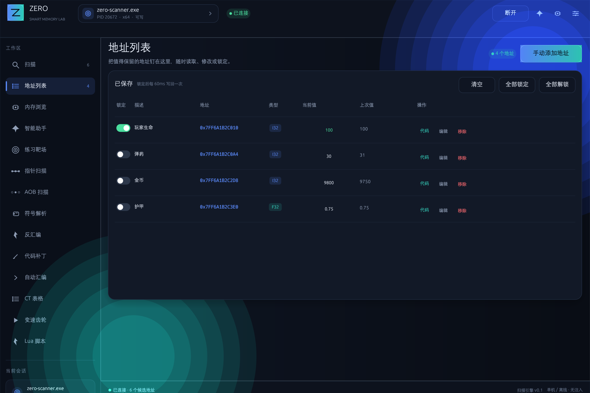
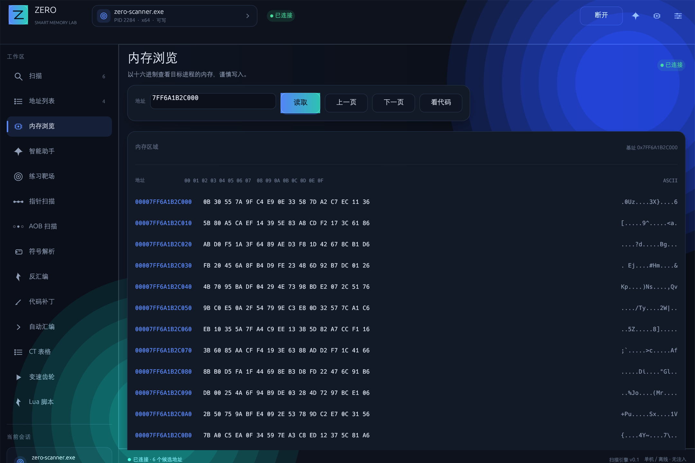

<div align="center">

# Zero

**现代、轻量的内存工作台 —— 本机推理，不联网，不上传**

扫描 → 定位 → 观察 → 修改，一条干净的桌面工作流。
用 Rust + egui 重写 Cheat Engine 的思路，纯自研，不含 CE 源码。

[](https://github.com/highho/zero-scanner/releases/latest)
[](#下载)
[](#从源码构建)
[](#架构)
[](#下载)
[](#智能化闭环)
[](LICENSE)

[下载](#下载) · [界面](#界面) · [自动更新](#自动更新) · [快速上手](#快速上手) · [功能](#功能) · [MCP 服务](#给-ai-用mcp-服务) · [架构](#架构) · [构建](#从源码构建) · [安全原则](#安全原则) · [许可证](#许可证)

</div>

---

## 下载

| 文件 | 说明 |
| --- | --- |
| [`zero-scanner-1.2.0-setup-x64.exe`](https://github.com/highho/zero-scanner/releases/latest) | 安装版：**不需要管理员权限**，装进用户目录，带桌面 / 开始菜单快捷方式与卸载项 |
| [`zero-scanner.exe`](https://github.com/highho/zero-scanner/releases/latest) | 便携版，单文件，双击即用 |
| [`zero-scanner-v1.2.0-windows.zip`](https://github.com/highho/zero-scanner/releases/latest) | 同一份 exe + 说明文档与界面截图 |

- **三种拿法，一个二进制**：便携版直接跑；zip 解压即用；安装版会装到 `%LOCALAPPDATA%\Programs\Zero`，写开始菜单和桌面快捷方式，卸载时**保留你的 `zero-workspace.json`**（地址列表、补丁记录都在里面）。
- **会自己更新**：装好之后，程序启动时自己检查新版本，一键下载替换、重启生效（走 `gh-proxy.com` 镜像，见 [自动更新](#自动更新)）。
- **无外部运行时**：Lua 5.4 通过 `mlua` 的 vendored feature 静态编进二进制，不需要另装 Lua，也不用装任何运行库。
- **只支持 Windows 10 / 11 x64**。
- 权限要跟得上目标：游戏以管理员身份运行时，Zero 也要以管理员身份运行，否则打不开进程。

## 快速上手

```text
1. 双击 zero-scanner.exe
2. Ctrl+O 选择进程 —— 或者直接进「练习靶场」，不碰真游戏也能把整套流程走一遍
3. 输入你在游戏里看到的数值，Ctrl+Enter 首次扫描
4. 回游戏让数值变化，F5 再次扫描，反复几次，候选就只剩个位数
5. 加入地址列表，锁定或改写 —— 每一次写入都留了撤销路径
```

第一次用建议先开练习靶场：它自带已知的内存布局（金币、血量、指针链、AOB 标记），可以放心改坏。

## 界面


图标和界面同一套语言：深色圆角砖、渐变 Z、外围一圈扫描环——「找一个值，然后盯住它」。

下面几张图都是 `--demo` 模式下的真实渲染，进程是内置练习靶场，不是摆拍。

**扫描**——左边是工作区，右边是智能建议：候选越少，它越想帮你收口。


**地址列表**——把值得留的地址钉住，锁定的地址每 60ms 写回一次，写入都可撤销。



**内存浏览**——十六进制直读目标进程，看到的每个字节都是真的。



**设置**——扫描偏好、MCP 服务和自动更新都在这里，更新卡片会直接写出目标版本、体积和发布说明。


更新卡片在设置页下方，写清楚当前版本、目标版本、体积和发布说明，跳过或关闭自动检查都记在这里：


**主题**——设置里一键切换 8 套内置主题；界面颜色全部来自运行时调色板，浅色深色都有。


## 主题与插件

Zero 1.2 把界面颜色从编译期常量换成了**运行时主题引擎**：

| 能力 | 说明 |
| --- | --- |
| 8 套内置主题 | 深空蓝（默认）/ 霓虹赛博 / 电竞紫 / 战术绿 / 暗夜琥珀 / 极光冰蓝 / 石墨灰 / 晨曦（浅色） |
| 主题包 | `%APPDATA%/Zero/themes/*.json`，继承内置主题再覆盖任意颜色，改完点「重新扫描」即生效 |
| 插件预留 | `%APPDATA%/Zero/plugins/<名>/plugin.json` 声明能力；目前已实现 `theme`（插件自带主题包），其余键安全忽略 |
| 命令行 | `--theme=<id>` 直接用指定主题启动；选择会记在 `%APPDATA%/Zero/prefs.json` |

格式细节与示例见 [docs/themes.md](docs/themes.md) 与 [docs/plugins.md](docs/plugins.md)；仓库里带了两个可用的主题包（[themes/](themes/)）和一个演示插件（[examples/plugins/](examples/plugins/)）。失败的包只会被跳过并在设置里列出原因，不会挡住启动。

## 自动更新

装好之后不用再手动下安装包：程序启动时自己查一次新版本，有就提示、下载、替换、重启，全程不弹 UAC。

| 环节 | 做法 |
| --- | --- |
| 查什么 | `GET https://gh-proxy.com/https://api.github.com/repos/highho/zero-scanner/releases/latest`，只读 tag、发布说明和资产清单 |
| 比什么 | 三段版本号数字比较，`v1.1.0` 与 `1.1.0` 等价；只认比当前版本更大的发布 |
| 下载哪个 | 优先裸 `zero-scanner.exe`（就地替换，不跑安装器），没有就退回 `*-setup-x64.exe` |
| 什么时候查 | 启动后自动查一次，之后最多每 6 小时一次；设置里可以整个关掉，也可以随时点「检查更新」 |
| 下载到哪 | `%TEMP%\zero-update`，先写 `.part`，字节数与发布信息对得上才改成正式文件 |
| 装之前查什么 | 文件还在不在、够不够大、开头是不是 MZ 头；缺一样就直接报错，不会拉起替换脚本 |
| 怎么换 | 生成一个 `apply.cmd`：等本进程退出 → `move /Y` 覆盖安装目录里的 exe → 启动新版 → 删掉自己 |
| 不想升 | 「跳过此版本」写进 `prefs.json`，重启后也不会再提这个版本，下个版本照常提醒 |
| 怎么关 | 设置里的「启动后自动检查更新」可以整个关掉，之后只能手动点「检查更新」 |

几个刻意的选择：

- **镜像可换**：默认走 `gh-proxy.com`（国内直连 GitHub 常常超时）。常量在 `app/src/update.rs`，改一个 `PROXY` 就行，留空则直连。
- **不加依赖**：HTTP 走 Windows 自带的 WinHTTP（`windows-sys` 已经在依赖里），没有引入 `reqwest` 之类的运行时；顺便处理了本机证书吊销检查离线的情况——严格握手失败时，带 `SECURITY_FLAG_IGNORE_REVOCATION` 再试一次。
- **失败不吵人**：自动检查连不上就安静地跳过，只有手动检查失败才提示原因，界面里也不会冒出更新失败的弹窗。
- **失败要看得见**：替换脚本把 `move` 的结果写进 `%TEMP%\zero-update\apply.log`（`OK` / `FAILED` / `STARTED`），不像以前那样把错误吞掉——「点了更新什么都没发生」是最难查的那种故障。
- **只读不报**：更新链路只从 GitHub 读版本和文件，不上报任何信息，不做统计。

自检命令（不打开界面，直接打印结论）：

```bash
zero-scanner.exe --update-check                # 查最新发布，打印结论
zero-scanner.exe --update-download <目录>       # 真的走一遍下载，把文件放到指定目录
zero-scanner.exe --update-download-any <目录>   # 忽略版本比较强制下载（验证下载链路用）
zero-scanner.exe --update-apply-from <文件>     # 走一遍替换并重启（验证更新脚本用）
```

## 功能

### 扫描与定位

| 功能 | 说明 |
| --- | --- |
| 数值扫描 | 9 种方式：精确值 / 大于 / 小于 / 区间 / 未知初值 / 增加 / 减少 / 变化 / 未变；支持 1-2-4-8 字节、单双精度浮点与字符串 |
| 快速扫描 | 按 4 字节对齐扫全进程，速度快到可以当第一遍粗筛 |
| 指针扫描 | 从一个地址反推「模块基址 + 若干偏移」的稳定链，重启后依然有效 |
| AOB 扫描 | 按字节特征找代码（支持 `??` 通配），定位到更新数值的那段指令 |
| 练习靶场 | 内置目标进程，离线练手，不需要真游戏 |

### 分析

| 功能 | 说明 |
| --- | --- |
| 符号解析 | 模块列表 + PE 导入表 / 导出表 |
| 内存浏览 | 按模块分区查看、跳转、跟随指针 |
| 结构浏览 | 把一块内存按字段拆开，猜每个偏移是指针 / 整数 / 浮点 / 文本，一键把字段加进地址列表 |
| 反汇编 | 自带 x86-64 反汇编器，指令边界与长度精确到字节 |
| 命中分诊 | 每个候选都带**可解释**的打分理由（是否可写、是否落在模块内、被引用的次数……），不是黑箱分数 |
| 地址表达式 | 所有地址输入框都认 `game.exe+0x4A0C8` 模块偏移、指针链 `game.exe+0x10,0x14`、十六进制与十进制 |

### 修改（全部可还原）

| 功能 | 说明 |
| --- | --- |
| 代码补丁 / 代码洞 | 写前读原字节、抬高页保护、写后恢复；每条可单独撤销，也能一键全撤 |
| 自动汇编 | 手写 x86-64 汇编，编完做一次往返校验，对不上就不写 |
| 变速齿轮 | 挂起 / 恢复目标线程，0.1x–10x；停过的线程保证会被放回去 |
| Lua 脚本 | CE 风格脚本：`readInteger` / `writeInteger` / `readBytes` / `writeBytes` / `getAddress` / `print` |
| CT 表格 | 读写 Cheat Engine 的 `.ct`，支持指针链地址解析 |

### 观测与智能化

| 功能 | 说明 |
| --- | --- |
| 观察队列 | 后台连续采样，回答「到底哪个地址在跟着我动」 |
| 反馈学习 | 标记「不是它」，从拒绝里提炼可泛化的特征，下次扫描直接把它排到后面 |
| 智能助手 | 本机规则给出下一步建议与诊断，不联网、不调用大模型 |

### 工作流

| 功能 | 说明 |
| --- | --- |
| 15 个工作区 | 扫描 / 地址列表 / 内存浏览 / 智能助手 / 练习靶场 / 指针扫描 / AOB 扫描 / 符号解析 / 反汇编 / 代码补丁 / 自动汇编 / CT 表格 / 变速齿轮 / Lua 脚本 / 结构浏览 |
| 工作区持久化 | 地址列表、补丁记录、观察候选与设置存在 exe 旁的 `zero-workspace.json`；文件损坏时降级为空，不会挡住启动 |
| 快捷键 | 沿用 CE 的肌肉记忆：F5 再次扫描、Ctrl+Z 撤销、Ctrl+F 全部锁定……F1 呼出速查 |

## 智能化闭环

不做云端大脑，只做一条**能在本机验证**的闭环：

```text
扫描命中（几百个地址）
   ↓  证据打分
分诊排序（每条带理由）
   ↓  动态采样
观察队列（谁真的在动）
   ↓  你标记「不是它」
反馈学习（提炼可泛化特征）
   ↺  回到分诊
```

- **证据排序**：先按目标内存的证据（区域权限、模块归属、引用密度）排序，让你从最像的开始看。
- **观察判定**：猜不准就交给时间——后台采样，看数值是否随操作变化。
- **反馈学习**：拒绝也要学到东西；同一条特征重复拒绝只记一次，不叠加惩罚。

## 给 AI 用：MCP 服务

Zero 可以把自己的引擎通过 MCP 暴露给本机的 AI 助手：**开就监听，关就一个端口都不占**。

两种开法：

- 界面里打开「设置 → MCP 服务」开关；
- 命令行起一个无界面的引擎：`zero-scanner.exe --mcp 3780`

启动后打印的就是要粘给客户端的地址：

```text
MCP listening on http://127.0.0.1:3780/mcp?token=9f2c1d...（32 位随机串）
```

- 传输：MCP over HTTP（JSON-RPC 2.0），请求 `POST /mcp?token=...`，`GET` 是健康检查。
- 不带 token 或 token 不对：一律 `401`。服务只监听 `127.0.0.1`，不对外。
- 服务自持一个**独立引擎会话**（自己的进程句柄、扫描状态、补丁账本），不和 GUI 共享可变状态。

### 14 个工具

| 分类 | 工具 | 能做什么 |
| --- | --- | --- |
| 连接 | `zero_attach` | 按 PID 或进程名连上一个正在运行的进程 |
| 连接 | `zero_status` | 当前连接、候选数量、已保存地址 |
| 扫描 | `zero_scan` | 首次扫描，返回候选数量与最可能的几个地址 |
| 扫描 | `zero_next_scan` | 在已有结果上再次扫描，用变化方向收窄 |
| 扫描 | `zero_candidates` | 按可信度列出候选，附打分理由 |
| 分析 | `zero_pointer_scan` | 为地址反推稳定指针链（模块基址 + 偏移） |
| 分析 | `zero_disassemble` | 反汇编一段代码：地址、字节、助记符 |
| 内存 | `zero_read_memory` | 读目标内存 |
| 内存 | `zero_write_memory` | 写目标内存，返回 undo 句柄 |
| 内存 | `zero_undo` | 还原本会话的写入（不带地址全还原，带地址只还原那处） |
| 观测 | `zero_watch` | 会话式观察队列：`start` 立即返回 → 去游戏里改值 → `status` 看谁跟着动 → `stop` |
| 表格 | `zero_ct_table` | `.ct` 的 `read` / `write` / `build` |
| 脚本 | `zero_lua` | 跑 CE 风格 Lua，直接读写目标进程 |
| 地址 | `zero_add_address` | 把地址加入地址列表 |

### 客户端配置示例

```json
{
  "mcpServers": {
    "zero": {
      "url": "http://127.0.0.1:3780/mcp?token=<你的 token>"
    }
  }
}
```

> 支持 Streamable HTTP 的客户端直接填 URL；只认 stdio 的客户端用 `mcp-remote` 之类的桥接一层即可。

### 让它写，也让它还得回来

`zero_write_memory` 成功时返回 undo 句柄；写失败不留半写状态。AI 改过的东西，人和 AI 都能逐条或一键还原。

## 命令行

| 命令 | 作用 |
| --- | --- |
| `zero-scanner.exe` | 图形界面 |
| `zero-scanner.exe --mcp <port>` | 无界面启动 MCP 服务（不写端口默认 3777） |
| `zero-scanner.exe --selftest` | 跑 136 项自检，结论写 `selftest.log`，退出码即结果 |
| `zero-scanner.exe --verify <pid>` | 对目标进程做 8 项可用性验证 |
| `zero-scanner.exe --e2e <pid> [info]` | 23 项端到端验证（配合 `e2e_target.py`） |
| `zero-scanner.exe --screenshot <png> --tab <名字>` | 渲染某个页面为 PNG（界面回归用，加 `--settings` 连设置弹窗一起） |
| `zero-scanner.exe --update-check` | 查最新发布并打印结论，不打开界面 |
| `zero-scanner.exe --update-download <目录>` | 走一遍真实下载，落到指定目录（校验用） |
| `zero-scanner.exe --update-download-any <目录>` | 忽略版本比较强制下载，用于验证下载链路 |
| `zero-scanner.exe --update-apply-from <文件>` | 走一遍「等退出→替换 exe→重启」的批处理 |
| `zero-scanner.exe --hotkeys` | 启动时展开快捷键速查 |
| `zero-scanner.exe --settings` | 启动时展开设置 |
| `zero-scanner.exe --practice-target` | 只跑内置靶场进程 |

`--tab` 取值：`scan` `list` `memory` `assistant` `practice` `ptr` `aob` `symbols` `disasm` `inject` `asm` `table` `speed` `script` `struct`。

## 快捷键

| 快捷键 | 动作 |
| --- | --- |
| `Ctrl+Enter` | 用当前设置开始扫描 |
| `F5` | 再次扫描（缩小结果） |
| `Ctrl+Z` | 撤销上一次扫描 |
| `Ctrl+F` | 全部锁定 / 全部解锁 |
| `Ctrl+O` | 选择进程 |
| `Ctrl+N` | 清空扫描结果 |
| `F8` | 回到地址列表 |
| `Ctrl+M` | 在内存中查看选中的结果 |
| `F1` | 显示 / 隐藏快捷键速查 |

## 架构

界面、业务、引擎三层分开，所有能力都收敛到同一个进程访问层：

| 层 | 模块 | 职责 |
| --- | --- | --- |
| 界面 | `ui.rs` · `theme.rs` | 14 个工作区与设计系统 |
| 业务 | `app.rs` | 状态、流程编排、事件分发 |
| 引擎 | `scan` `aob` `pointerscan` `syms` `disasm` `assembler` `inj` `speed` `lua` `ctable` | 每项能力一个独立模块，互不越界 |
| 智能 | `triage` `focus` `smart` | 证据打分、观察队列、本机建议 |
| 底座 | `winmem.rs` | 进程句柄、内存读写、模块枚举 |
| 对外 | `mcp.rs` | 本机 HTTP MCP 服务（独立引擎会话） |

依赖只有 `eframe` / `egui` 0.27、`mlua`（Lua 5.4，vendored）、`serde`、`windows-sys`。反汇编器、汇编器、CT 解析、MCP 服务全部手写——**没有异步运行时，也没有 iced-x86 / capstone / tokio**。

<details>
<summary>目录结构</summary>

```text
.
├─ app/
│  ├─ Cargo.toml
│  └─ src/
│     ├─ main.rs         入口与命令行
│     ├─ app.rs          状态与业务
│     ├─ ui.rs           全部界面
│     ├─ theme.rs        设计系统
│     ├─ scan.rs         数值扫描
│     ├─ aob.rs          字节特征扫描
│     ├─ pointerscan.rs  指针链
│     ├─ syms.rs         PE 导入 / 导出表解析
│     ├─ disasm.rs       x86-64 反汇编
│     ├─ assembler.rs    汇编与往返校验
│     ├─ inj.rs          可逆代码补丁
│     ├─ winmem.rs       进程、内存读写、模块枚举
│     ├─ triage.rs       命中分诊（证据打分）
│     ├─ focus.rs        观察队列
│     ├─ smart.rs        本机规则助手
│     ├─ practice.rs     练习靶场
│     ├─ ctable.rs       CT 表格
│     ├─ speed.rs        变速齿轮
│     ├─ lua.rs          Lua 脚本
│     ├─ session.rs      工作区持久化
│     ├─ hotkey.rs       快捷键
│     ├─ mcp.rs          MCP 服务
│     ├─ selftest.rs     136 项自检
│     ├─ e2e.rs          端到端验证
│     └─ model.rs        值类型与扫描类型
└─ e2e_target.py         端到端测试目标进程
```

</details>

## 从源码构建

需要 Rust stable 工具链和 Windows 的 MSVC 链接器：

```bash
git clone https://github.com/highho/zero-scanner.git
cd zero-scanner/app
cargo build --release
# 产物：app/target/release/zero-scanner.exe
```

仓库里提交了 `Cargo.lock`，构建结果是可复现的。第一次构建要编 vendored Lua，会比之后慢一些。

`build.rs` 会在构建时用 Windows SDK 的 `rc.exe` 把图标（`app/icon/zero.ico`）和版本信息嵌进 exe——找不到 `rc.exe` 只给一条警告，不影响编译，只是产物没有图标和版本号。图标在窗口里用的是 `app/assets/icon.png`。

版本号要改两处：`app/Cargo.toml` 的 `version`（exe 版本信息、MCP 的 `serverInfo`、界面里的「当前 v…」都读它）和 `installer/Zero.nsi` 的 `APP_VERSION`（安装包文件名和卸载项显示）。

打包成安装程序（可选，需要 [NSIS](https://nsis.sourceforge.io/Download) 3.x 的 `makensis` 在 `PATH` 上）：

```bash
cp app/target/release/zero-scanner.exe dist/
bash installer/build.sh
# 产物：dist/zero-scanner-1.2.0-setup-x64.exe
```

安装逻辑在 [`installer/Zero.nsi`](installer/Zero.nsi)（版本号在这里改），图标是 [`installer/zero.ico`](installer/zero.ico)（与 `app/icon/zero.ico` 是同一份文件）。安装包默认装到用户目录、申请的是用户级权限，所以整个流程不用弹 UAC。

## 测试与验证

两条独立的证据线：**断言管逻辑，截图管渲染**。

```bash
# 136 项自检：扫描 / 指针 / 反汇编 / 补丁 / 汇编 / CT / 分诊 / Lua / 更新 / 偏好 ……
zero-scanner.exe --selftest

# 23 项端到端：起一个真实目标进程，把整条链路跑一遍
python e2e_target.py
zero-scanner.exe --e2e <pid> e2e_target.info
```

`e2e_target.py` 会公布自己的金币 / 血量地址、指针链和 AOB 标记；端到端验证就对这些真实地址读写、打补丁、还原。界面回归用 `--screenshot` 逐页渲染 PNG 比对。

## 安全原则

- **写入必须可还原**：每次补丁都先读出原字节，可逐条撤销，也能一键全撤。
- **不杀不属于你的进程**：变速只挂起目标线程，并且拒绝对自己进程操作；挂起过的线程保证被放回。
- **不假设可以覆盖**：写文件（如 `.ct`）前必须显式确认。
- **出错不编结果**：地址解析失败就报错，绝不返回一个假地址。
- **只读优先**：能只读就不写，需要写的时候先把退路铺好。

## 已知限制

- 只有 Windows x64 版本，没有内核驱动——带内核态反作弊保护的游戏，基本打不开或写不进。
- 不做 DLL 注入：补丁与代码洞都是"改字节 + 可还原"，不是往目标里塞模块。
- 目标是**你自己的程序、单机游戏和学习实验**。

## 说明

Zero 是纯自研实现，不包含、也不移植 Cheat Engine 的源码；界面与交互按现代桌面工具的审美重做，快捷键与术语尽量照顾 CE 老用户的手感。

> 仅供学习、研究与调试你自己拥有或获授权调试的程序。把它用在联机游戏或别人的机器上，后果自负。

## 许可证

MIT，见 [LICENSE](LICENSE)。你可以自由使用、修改、再分发，保留版权声明即可。

